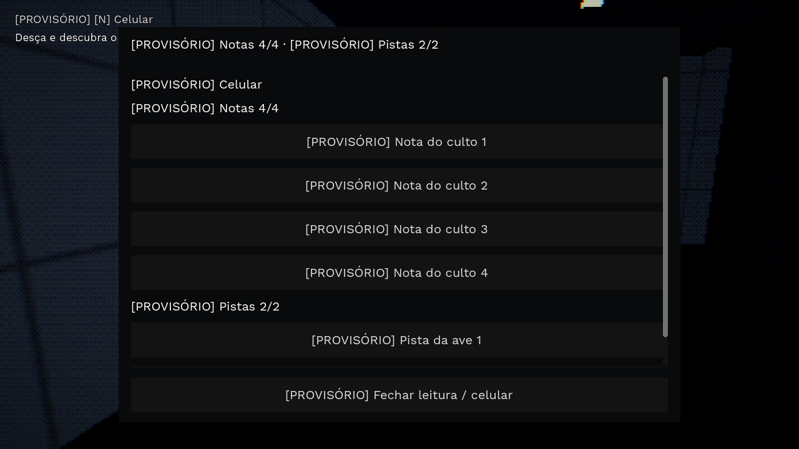
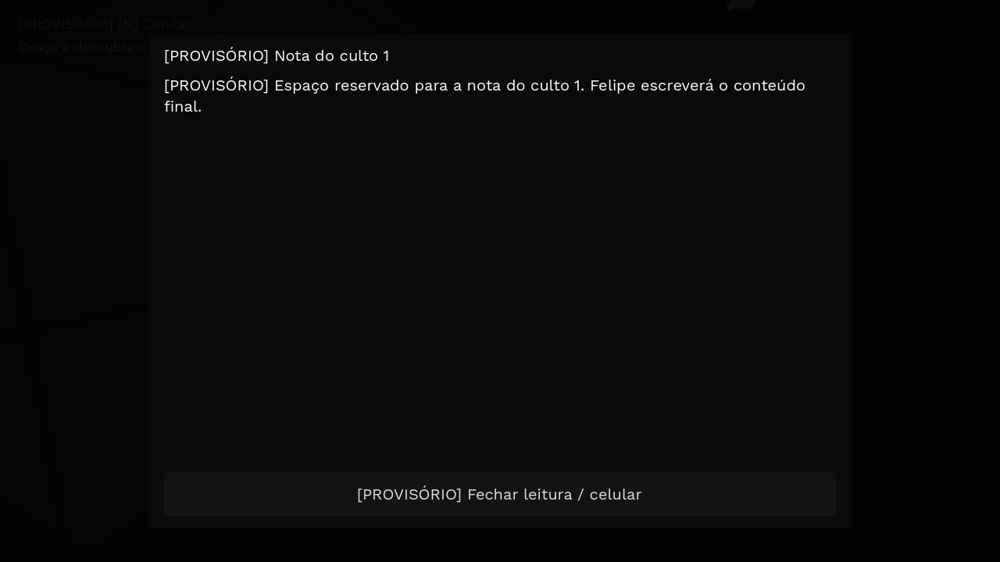
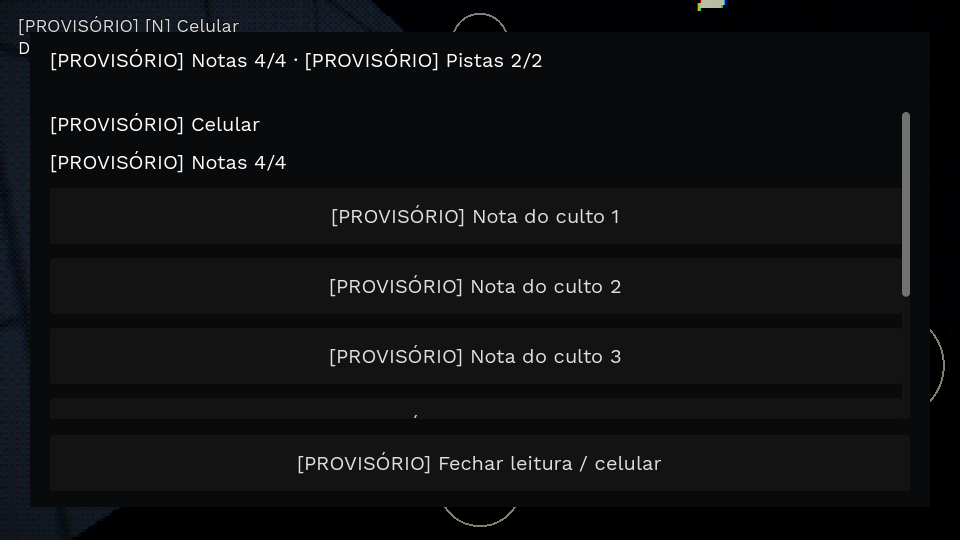
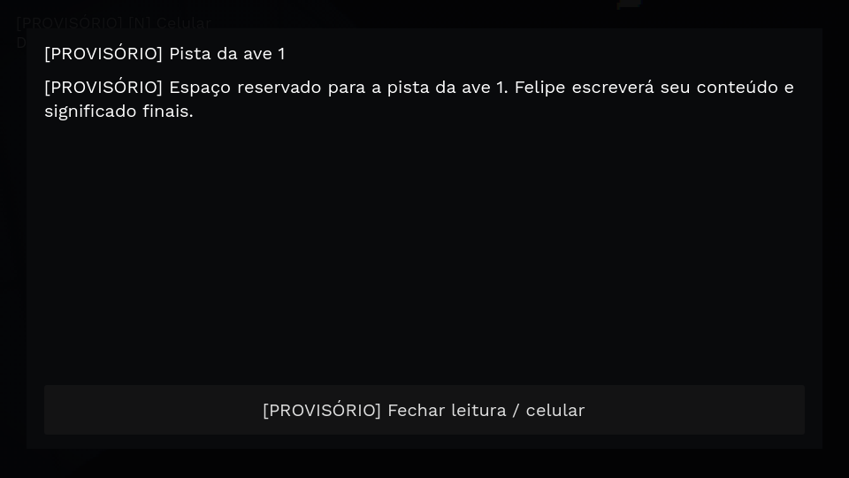

# Objetivos da Etapa 4 — 03/11/2026

Branch `feat/prototipo-terror-terceira-pessoa`, Godot 4.5.1 Compatibility.

## Entrega e limite da base

Chave, item opcional, quatro notas, duas pistas, leitor PC/toque, registros no
celular e estado nos checkpoints foram integrados ao capítulo existente. A grade,
a iluminação e os modelos foram preservados. Os pickups são volumes pequenos do
bloqueio cinza, sem decoração. Nenhum código ou teste novo escreve pose de osso.

**A nova abertura diurna e o encontro de timing na cozinha do Prompt C ainda não
existem nesta base.** O storyboard recebido foi preservado em
[storyboard-cozinha.png](referencias/storyboard-cozinha.png). A medição abaixo
cobre o capítulo que realmente roda, com sua abertura antiga, a chave, a bolsa,
o ritual e a fuga. Não representa a duração de uma sequência cinematográfica que
ainda não foi implementada. Não foi acrescentada essa frente ao escopo dos objetivos.

A barra superior mostra a maior suspeita existente da IA a até 10,5 m e some longe,
no passeio debug ou durante a leitura. A detecção e a caça existentes continuam;
não foi implementada aqui a morte por vigilância cheia na cozinha do Prompt C.

## Onde ficam os itens

Células na mesma convenção da grade: coluna, linha, andar. O nome e a natureza
final do item consumível continuam provisórios.

| ID | Sala / célula | Papel |
| --- | --- | --- |
| `chave` | Estoque da cozinha, (98,33), térreo | Obrigatória; a entrada passa pela área do posto 6 no refeitório. |
| `finalizador` | 3 Contabilidade, (10,7), térreo | Opcional, fora do caminho obrigatório; emissão fraca no próprio material, sem luz nova. |
| `nota_1` | Estoque da cozinha, (98,31), térreo | Na passagem necessária para buscar a chave, mas leitura opcional. |
| `nota_2` | Laboratório de hardware, (49,36), térreo | Desvio opcional. |
| `nota_3` | Biblioteca, (86,11), térreo | Desvio opcional. |
| `nota_4` | Sala dos professores, (73,51), térreo | Desvio opcional. |
| `pista_1` | Laboratório de química, (44,7), térreo | Desvio opcional. |
| `pista_2` | Banheiro feminino, (34,53), térreo | Desvio opcional. |

Apenas a porta **3 Informática**, que dá acesso à bolsa no superior, tem tranca.
A justificativa provisória é que o culto fechou a sala. Nenhuma chave adicional
ou tranca em outra porta foi criada. A chave permanece no inventário; ao interagir
com a porta, ela destranca e abre pelo gesto existente, pela folha articulada e
pelo som importado. Sem chave, a porta permanece fechada, inclusive se a IA tentar
abri-la. O F9 mantém a exceção de passeio debug; sair dele retoma o checkpoint.

O consumível é usado automaticamente no próximo contato de um cultista comum,
finaliza esse inimigo com `Death01` pelo controlador de animação e se perde.
O perseguidor sempre abre o escape normal, preservando o item. A faca antiga
não substitui esse consumível. Não há obrigação de encontrar o item ou os registros.

## PC e toque

- **Espaço / AÇÃO:** pegar chave/item ou ler nota/pista próxima, olhando para ela.
  Paredes e portas fechadas bloqueiam a coleta; não se pega à distância.
- Após obter a bolsa, **N / botão CELULAR** abre as listas **Notas 0/4** e
  **Pistas 0/2**. Os contadores ficam no alto do painel; registros já lidos podem
  ser abertos novamente. Antes da bolsa, os achados são memorizados e aparecem
  no celular assim que ele for recuperado.
- A lista do celular **não pausa a ameaça**. Abrir o texto de um registro pausa
  apenas enquanto a leitura estiver aberta. **Esc / Espaço / Fechar** devolve o
  controle e a ameaça. No toque, arraste a lista para rolar; Fechar fica sempre
  visível, com área de toque de 56 px de altura.
- Ao pegar a chave e ao pegar a bolsa, o checkpoint é salvo automaticamente.
  Inventário, registros, tranca, consumo e cultista finalizado acompanham o
  checkpoint. Uma morte desfaz os achados/uso posteriores ao último checkpoint,
  junto com o restante do estado do mundo; não duplica o consumível.

O formato de save passou a 5; saves de formato 4 com a bolsa já obtida recebem
chave/acesso para preservar a partida antiga. Nenhum save antigo é apagado.

## Textos para Felipe substituir

Todo texto novo de jogo está em
[`objetivos.json`](../godot-3d/capitulo1/textos/objetivos.json), uma lista com
`id`, `titulo` e `texto`. Títulos e textos começam com `[PROVISÓRIO]`.
Preserve os IDs e a estrutura JSON ao editar títulos e textos.
O arquivo inclui `fome`, exibido ao terminar a abertura atual, sem fala nova de
Miguel. Notas e pistas reservam espaço para o texto final; nenhum significado da
ave ou revelação do culto foi inventado. Os outros IDs são rótulos e dicas da interface.

O JSON é lido como texto do pacote de recursos. O preset Web já inclui `*.json`.
Os sons continuam sendo recursos importados carregados por `load()`.

## Duração: curta para a meta

- Percurso físico principal implementado: **207,3 s (3 min 27 s)**, sem mortes,
  sem item de finalizar e sem notas/pistas. A percepção dos comuns é isolada no
  modo `rota`, como no teste existente; isso mede geometria e fluxo, não dificuldade.
- Exploração: A* do cenário encontra **299,19 m** entre chave e escada passando
  pelos sete opcionais, contra **79,23 m** direto. Desvio mínimo: **219,95 m**, ou
  **151,69 s** andando a 1,45 m/s. Portas abertas somente na instância de medição.
- Estimativa com exploração: **9–13 min**, somando ao percurso e ao desvio
  **1–2 min** de leitura dos seis textos provisórios curtos e **2–5 min** de procura/espera. São hipóteses, não uma
  partida humana cronometrada. Os textos finais de Felipe e a abertura/cozinha
  pendentes ainda não têm duração medida.

A meta **20–30 min não foi atingida nem marcada como concluída**. Sugestões para
avaliar depois, sem conteúdo criado nesta entrega: medir as cenas já pedidas
quando forem integradas; medir os textos finais; testar a espera real para passar
pelos guardas; revisar o ritmo da exploração existente com Felipe. Nenhuma missão,
nota extra, sala, inimigo ou trecho de caminhada foi inventado para alongar o jogo.
Dados e hipóteses: [duracao-exploracao.json](verificacao-objetivos/duracao-exploracao.json).

## Verificação visual

As quatro capturas foram abertas e conferidas. Textos legíveis, contadores 4/4
e 2/2, leitura em painel opaco e botão Fechar acessível. A lista rola no toque.
São capturas da interface com os registros coletados pela mesma interação do jogo;
não representam uma partida completa nem aprovação visual de Felipe.









Reproduzir na raiz do projeto:

```bash
GODOT=work/ferramentas/godot/Godot.app/Contents/MacOS/Godot
"$GODOT" --path godot-3d -s res://tools/capturar_objetivos.gd
"$GODOT" --headless --path godot-3d -s res://tools/medir_objetivos.gd
# Para conferir os botões de toque no Mac:
"$GODOT" --path godot-3d res://capitulo1/main.tscn -- --toque
```

## Saídas completas dos testes

As transcrições abaixo preservam também os avisos e diagnósticos existentes.
O diagnóstico `TRAVOU` diante do portão indica o corpo chegando à grade antes da
animação de transposição; o teste exige, em seguida, o salto e o encerramento.

Resultado: **341 testes do capítulo, 9 do percurso e 15 do nível; zero falhas; três comandos com saída 0.**

<details>
<summary>bash scripts/testar-capitulo1.sh — saída completa</summary>

```text
Godot Engine v4.5.1.stable.official.f62fdbde1 - https://godotengine.org

PASSO_MEDIDO Walk ciclo=1.333 s passo=1.274 m nativo=0.956 m/s
PASSO_MEDIDO Sprint ciclo=0.667 s passo=2.335 m nativo=3.503 m/s
PASSO_MEDIDO Crouch_Fwd ciclo=2.000 s passo=1.279 m nativo=0.640 m/s
PASSO_MEDIDO Walking_Backwards ciclo=0.967 s passo=1.215 m nativo=1.257 m/s
PASSO_MEDIDO Ascending_Stairs ciclo=1.367 s passo=0.450 m nativo=0.329 m/s
PASSO_MEDIDO Running_Up_Stairs ciclo=0.600 s passo=0.363 m nativo=0.605 m/s
PASSO_MEDIDO Descending_Stairs ciclo=0.933 s passo=0.264 m nativo=0.283 m/s
PASSO_MEDIDO Roll ciclo=1.467 s passo=3.256 m nativo=2.220 m/s
PASS textos centralizados incluem pensamento provisório da fome
PASS todo texto e título novo está marcado PROVISÓRIO
PASS só o acesso da bolsa tem tranca
PASS sem chave, nem abertura direta nem interação destrancam
PASS não pega a bolsa sem obter a chave
PASS não coleta chave à distância
PASS interação guarda chave no inventário e remove pickup
PASS pegar chave salva checkpoint automático na posição real
PASS chave destranca apenas a porta da bolsa
PASS porta abre por animação articulada e emite som existente
PASS porta destrancada usa áudio importado
PASS ler nota_1 abre tela e pausa ameaça
PASS fechar nota_1 devolve ameaça e controle
PASS ler nota_2 abre tela e pausa ameaça
PASS fechar nota_2 devolve ameaça e controle
PASS ler nota_3 abre tela e pausa ameaça
PASS fechar nota_3 devolve ameaça e controle
PASS ler nota_4 abre tela e pausa ameaça
PASS fechar nota_4 devolve ameaça e controle
PASS ler pista_1 abre tela e pausa ameaça
PASS fechar pista_1 devolve ameaça e controle
PASS ler pista_2 abre tela e pausa ameaça
PASS fechar pista_2 devolve ameaça e controle
PASS quatro notas e duas pistas coletadas e contadas
PASS reler ou tentar pegar nota repetida não duplica registro
PASS celular abre listas sem pausar a ameaça
PASS celular lista seis registros e botão de fechar
PASS reler registro pelo celular pausa apenas a leitura
PASS toque oferece botão do celular
PASS botão de celular do toque abre a lista
LEITURA_TOQUE altura_lista=448.0 altura_janela=307.200012207031 max=448.0
PASS toque arrasta a lista de registros sem mover Miguel
PASS fechar permanece visível mesmo com lista longa
PASS toque abre leitura de um registro pela lista
PASS botão de fechar do toque restaura o jogo
PASS item opcional escondido é guardado
PASS item finaliza cultista comum e é consumido
PASS mesmo item não pode finalizar um segundo comum
PASS item nunca finaliza perseguidor nem é consumido nele
PASS checkpoint restaura registros e finalização sem duplicar uso
PASS barra superior mostra vigilância de cultista próximo
PASS barra de vigilância some longe dos cultistas
PASS oito pickups em piso livre de salas existentes
CAPITULO1_OBJETIVOS: 42 passed, 0 failed

Godot Engine v4.5.1.stable.official.f62fdbde1 - https://godotengine.org

PASSO_MEDIDO Walk ciclo=1.333 s passo=1.274 m nativo=0.956 m/s
PASSO_MEDIDO Sprint ciclo=0.667 s passo=2.335 m nativo=3.503 m/s
PASSO_MEDIDO Crouch_Fwd ciclo=2.000 s passo=1.279 m nativo=0.640 m/s
PASSO_MEDIDO Walking_Backwards ciclo=0.967 s passo=1.215 m nativo=1.257 m/s
PASSO_MEDIDO Ascending_Stairs ciclo=1.367 s passo=0.450 m nativo=0.329 m/s
PASSO_MEDIDO Running_Up_Stairs ciclo=0.600 s passo=0.363 m nativo=0.605 m/s
PASSO_MEDIDO Descending_Stairs ciclo=0.933 s passo=0.264 m nativo=0.283 m/s
PASSO_MEDIDO Roll ciclo=1.467 s passo=3.256 m nativo=2.220 m/s
PASS F9 abre passeio direto do menu em debug
PASS passeio oculta inimigos/ritual e remove colisões e áreas de acerto
PASS Miguel anda com input e física normais no passeio
PASS inimigo próximo não detecta nem agarra no passeio
PASS passeio não gera perseguidor
PASS pressão fica desligada no passeio
PASS passeio não coleta bolsa nem inicia roteiro
PASS F9 sai e restaura os inimigos do checkpoint
PASS saída retoma o checkpoint sem salvar o passeio
CAPITULO1_PASSEIO: 9 passed, 0 failed

Godot Engine v4.5.1.stable.official.f62fdbde1 - https://godotengine.org

PASSO_MEDIDO Walk ciclo=1.333 s passo=1.274 m nativo=0.956 m/s
PASSO_MEDIDO Sprint ciclo=0.667 s passo=2.335 m nativo=3.503 m/s
PASSO_MEDIDO Crouch_Fwd ciclo=2.000 s passo=1.279 m nativo=0.640 m/s
PASSO_MEDIDO Walking_Backwards ciclo=0.967 s passo=1.215 m nativo=1.257 m/s
PASSO_MEDIDO Ascending_Stairs ciclo=1.367 s passo=0.450 m nativo=0.329 m/s
PASSO_MEDIDO Running_Up_Stairs ciclo=0.600 s passo=0.363 m nativo=0.605 m/s
PASSO_MEDIDO Descending_Stairs ciclo=0.933 s passo=0.264 m nativo=0.283 m/s
PASSO_MEDIDO Roll ciclo=1.467 s passo=3.256 m nativo=2.220 m/s
PASS sem caça não há tensão ou pressão residual
PASS alerta salvo sozinho não liga pressão sem caçador
PASS busca longe mantém tensão baixa, mesmo sem visão
PASS tensão usa recurso marcado provisório, carregado por load
PASS proximidade aumenta pressão e reforço dos passos pesados
PASS reforço chega ao emissor 3D dos passos novos
PASS respiração acelera e cresce quando caçador chega perto
PASS tremor óptico é perceptível e limitado a 4,5 mm
PASS pressão não move o corpo de Miguel
PRESSAO longe=0.200 perto=0.962 reforco_passo=4.58 dB tremor=0.00421 m
PASS fim da última caça apaga tensão após retorno suave
PASS respiração volta ao perfil normal
PASS câmera volta ao repouso
PASS vídeo sem alerta não cria perseguidor
PASS alerta sem vídeo mantém o gatilho existente da apresentação
PASS perseguidor nasce só após alerta, no posto 8, mantendo sete comuns
PASS gatilho não cria um segundo perseguidor
PASS perseguidor sozinho sustenta a pressão da fuga
PASS pausa silencia pressão e respiração
PASS checkpoint limpa pressão e perseguidor
CAPITULO1_PRESSAO: 19 passed, 0 failed

Godot Engine v4.5.1.stable.official.f62fdbde1 - https://godotengine.org

PASSO_MEDIDO Walk ciclo=1.333 s passo=1.274 m nativo=0.956 m/s
PASSO_MEDIDO Sprint ciclo=0.667 s passo=2.335 m nativo=3.503 m/s
PASSO_MEDIDO Crouch_Fwd ciclo=2.000 s passo=1.279 m nativo=0.640 m/s
PASSO_MEDIDO Walking_Backwards ciclo=0.967 s passo=1.215 m nativo=1.257 m/s
PASSO_MEDIDO Ascending_Stairs ciclo=1.367 s passo=0.450 m nativo=0.329 m/s
PASSO_MEDIDO Running_Up_Stairs ciclo=0.600 s passo=0.363 m nativo=0.605 m/s
PASSO_MEDIDO Descending_Stairs ciclo=0.933 s passo=0.264 m nativo=0.283 m/s
PASSO_MEDIDO Roll ciclo=1.467 s passo=3.256 m nativo=2.220 m/s
AUDIO_RECURSOS carregados=376/376
PASS todos os 376 áudios do pacote carregam por load e têm duração
PASS três sons sem equivalente continuam carregando como recursos
PASS cada som referenciado pelo jogo possui recurso e medição
AUDIO_NIVEL pico_decodificado_com_ganho=-9.00 dBFS
PASS decodificação independente confirma pico dos sons usados
PASS ganho medido limita pico individual a -9 dBFS antes dos buses
PASS Master tem um limitador de segurança com teto -1 dBFS
PASS mapa real distingue azulejo e cimento
PASS lance real da escada seleciona pedra/concreto
PASS passos variam sem repetir o mesmo arquivo imediatamente
PASS troca de piso muda o banco de passos
PASS escada recebe ressonância curta própria
PASS passos do cultista são 3D, seguem o corpo e chegam a 10 m
PASS Miguel tem alcance de 7 m; comum tem timbre mais pesado
PASS perseguidor tem passos próprios mais graves e espaciais
PASS grito real do cultista usa voz fornecida e alcance de 10 m
PASS porta toca abertura e fechamento ao mudar estado
PASS armário toca rangido e fecho
PASS bolsa toca manuseio somente no contato confirmado
PASS portão toca contato metálico durante escalada
PASS agarrão toca impacto e roupa no corpo correto
PASS agarrão muda perfil da respiração provisória preservada
PASS cada acerto e conclusão do minigame têm som
PASS seta errada toca erro e falha
PASS prazo esgotado também toca falha
PASS respiração normal fica ativa em exploração
PASS corrida muda ritmo e volume da respiração
PASS deslocamento físico dispara passos pelo piso no process do jogo
PASS parado não repete passos
AUDIO_MIX pico_master=-11.87 dBFS
PASS mistura simultânea permanece abaixo de -1 dBFS
PASS pausa silencia respiração
CAPITULO1_AUDIO: 30 passed, 0 failed

Godot Engine v4.5.1.stable.official.f62fdbde1 - https://godotengine.org

PASSO_MEDIDO Walk ciclo=1.333 s passo=1.274 m nativo=0.956 m/s
PASSO_MEDIDO Sprint ciclo=0.667 s passo=2.335 m nativo=3.503 m/s
PASSO_MEDIDO Crouch_Fwd ciclo=2.000 s passo=1.279 m nativo=0.640 m/s
PASSO_MEDIDO Walking_Backwards ciclo=0.967 s passo=1.215 m nativo=1.257 m/s
PASSO_MEDIDO Ascending_Stairs ciclo=1.367 s passo=0.450 m nativo=0.329 m/s
PASSO_MEDIDO Running_Up_Stairs ciclo=0.600 s passo=0.363 m nativo=0.605 m/s
PASSO_MEDIDO Descending_Stairs ciclo=0.933 s passo=0.264 m nativo=0.283 m/s
PASSO_MEDIDO Roll ciclo=1.467 s passo=3.256 m nativo=2.220 m/s
PASS visão real detecta Miguel em área aberta
PASS ser visto interrompe a caminhada e inicia aviso
PASS cultista permanece parado durante 0,4 s
PASS após pausa, grita e começa perseguição
PASS grito espalha o alerta
PASS perseguição usa 3,0 m/s
PASS perseguição toca corrida original
CACA_CORRIDA deslocamento=1.0000 m em 0.333 s velocidade=3.000 clipe=novo/Sprint
PASS deslocamento físico confirma 3,0 m/s
PASS visão contínua não repete grito a cada quadro
PASS parede bloqueia visão real
PASS perdeu visão: vai ao último local visto, sem rastrear posição oculta
PASS busca de 60 s começa ao chegar ao último ponto
PASS perder visão não encerra busca em poucos segundos
PASS caça anda entre pontos e olha em volta com o corpo
PASS pontos de busca pertencem à região lembrada
PASS busca continua antes dos 60 s
PASS após 60 s sem visão, volta ao posto
PASS retorno lento a 0,8 m/s para o posto original
PASS chegada ao posto retoma patrulha
PASS somente quem viu entrar conhece o armário
PASS esconderijo oculta Miguel mesmo de quem lembra onde entrou
PASS testemunha abre a folha do armário
PASS viu entrar: tira Miguel do armário e abre minigame
PASS extração mantém separação entre corpos
PASS não viu a entrada: não conhece o armário
PASS sem testemunha: ronda por perto sem abrir nem agarrar
PASS perseguidor ronda perto, mas não abre armário cuja entrada não viu
CACA_VANTAGEM miguel=1.45 m/s variacao_distancia=-1.550 m
PASS Miguel andando perde distância
CACA_VANTAGEM miguel=3.80 m/s variacao_distancia=0.800 m
PASS Miguel correndo ganha distância
PASS vários caçadores escolhem lados distintos de Miguel
PASS cerco mantém cápsulas separadas, sem empilhar
PASS cerco abandona desvio bloqueado por parede e mantém aproximação
CACA_CERCO menor_distancia=0.7624 m destinos=3
CAPITULO1_CACA: 32 passed, 0 failed

Godot Engine v4.5.1.stable.official.f62fdbde1 - https://godotengine.org

PASSO_MEDIDO Walk ciclo=1.333 s passo=1.274 m nativo=0.956 m/s
PASSO_MEDIDO Sprint ciclo=0.667 s passo=2.335 m nativo=3.503 m/s
PASSO_MEDIDO Crouch_Fwd ciclo=2.000 s passo=1.279 m nativo=0.640 m/s
PASSO_MEDIDO Walking_Backwards ciclo=0.967 s passo=1.215 m nativo=1.257 m/s
PASSO_MEDIDO Ascending_Stairs ciclo=1.367 s passo=0.450 m nativo=0.329 m/s
PASSO_MEDIDO Running_Up_Stairs ciclo=0.600 s passo=0.363 m nativo=0.605 m/s
PASSO_MEDIDO Descending_Stairs ciclo=0.933 s passo=0.264 m nativo=0.283 m/s
PASSO_MEDIDO Roll ciclo=1.467 s passo=3.256 m nativo=2.220 m/s
PASS agarrão oferece sequência direcional
PASS encostar no cultista comum abre o minigame
PASS primeiro agarrão: 3 setas, 3,0 s
PASS sequência contém somente quatro direções válidas
PASS corpos separados em aproximadamente 0,6 m
PASS os dois ficam de frente
PASS agarrão mantém corpos sem atravessar
PASS segurar tecla, soltá-la ou apertar Q não resolve a sequência
PASS pausa suspende prazo do minigame
PASS sequência correta solta Miguel e atordoa cultista
PASS acerto faz recuo curto de 30 cm pela física
PASS acerto concede 1,5 s de vantagem
PASS atordoamento dura pelo menos 1,99 s
PASS atordoamento termina após 2 s
PASS vantagem impede agarrão imediato de outro cultista
PASS segundo agarrão: 4 setas, 2,7 s
PASS uma seta errada causa tela preta por 1,5 s
PASS input não pula os 1,5 s de tela preta
PASS erro retorna automaticamente ao checkpoint
PASS checkpoint preserva crescimento por agarrão nesta partida
PASS tempo esgotado também falha sem input
PASS tempo esgotado volta ao checkpoint
PASS crescimento: +1 seta/-0,3 s, máximo 7 e mínimo 1,5 s
PASS sorteio produz sequências diferentes
PASS item finaliza comum, evita agarrão e consome uso
PASS faca antiga não substitui o item futuro nem pula minigame
PASS perseguidor agarra; item não o finaliza nem é consumido
PASS perseguidor respeita raio maior sem atravessar Miguel
PASS acerto também atordoa perseguidor por 2 s
PASS perseguidor retoma caça vivo após atordoamento
APROX comum distancia=0.58000242710114 active=true
PASS cultista aproxima pela física até encostar, sem parar a 1,05 m
APROX perseguidor pos=(200.0, 0.000838, 200.66) estado=grab_hold distancia=0.66000419855118 active=true
PASS perseguidor aproxima pela física até encostar, sem parar a 0,83 m
PASS celular mostra quatro setas com alvos de pelo menos 64 px
PASS entrada no minigame solta analógico e mostra sequência
PASS toque acerta a sequência; setas somem ao soltar
PASS seta errada no celular também falha
PASS falha por toque também restaura checkpoint
CAPITULO1_ESCAPE: 37 passed, 0 failed

Godot Engine v4.5.1.stable.official.f62fdbde1 - https://godotengine.org

PASSO_MEDIDO Walk ciclo=1.333 s passo=1.274 m nativo=0.956 m/s
PASSO_MEDIDO Sprint ciclo=0.667 s passo=2.335 m nativo=3.503 m/s
PASSO_MEDIDO Crouch_Fwd ciclo=2.000 s passo=1.279 m nativo=0.640 m/s
PASSO_MEDIDO Walking_Backwards ciclo=0.967 s passo=1.215 m nativo=1.257 m/s
PASSO_MEDIDO Ascending_Stairs ciclo=1.367 s passo=0.450 m nativo=0.329 m/s
PASSO_MEDIDO Running_Up_Stairs ciclo=0.600 s passo=0.363 m nativo=0.605 m/s
PASSO_MEDIDO Descending_Stairs ciclo=0.933 s passo=0.264 m nativo=0.283 m/s
PASSO_MEDIDO Roll ciclo=1.467 s passo=3.256 m nativo=2.220 m/s
TRANSICAO velocidade=1.45 agachado=false salto_medido=0.0755 m
PASS troca de locomoção usa crossfade real da máquina
TRANSICAO velocidade=3.80 agachado=false salto_medido=0.1627 m
PASS troca de locomoção usa crossfade real da máquina
AVISO amplitude da pose original/transição supera 8 cm; não limitar ossos
TRANSICAO velocidade=0.00 agachado=false salto_medido=0.0871 m
PASS troca de locomoção usa crossfade real da máquina
AVISO amplitude da pose original/transição supera 8 cm; não limitar ossos
TRANSICAO velocidade=1.05 agachado=true salto_medido=0.0944 m
PASS troca de locomoção usa crossfade real da máquina
AVISO amplitude da pose original/transição supera 8 cm; não limitar ossos
TRANSICAO velocidade=0.00 agachado=true salto_medido=0.0622 m
PASS troca de locomoção usa crossfade real da máquina
TRANSICAO velocidade=1.45 agachado=false salto_medido=0.0777 m
PASS troca de locomoção usa crossfade real da máquina
PASS arestas: 0,15 s no plano e 0,20–0,25 s em ações/escada
ORIGINAL Miguel clipe=novo/Walk certo=180/180 avanca=180/180 erro_pos=0.0000001 erro_rot=0.0000001 apoio=168 deriva=0.1248 m
PASS Miguel: clipe correto avança sem congelar
PASS Miguel: todos os ossos coincidem com as trilhas originais
AVISO Miguel: deriva/contato original registrado; nenhuma correção de pose
ORIGINAL Miguel clipe=novo/Sprint certo=180/180 avanca=180/180 erro_pos=0.0000001 erro_rot=0.0000001 apoio=14 deriva=0.1077 m
PASS Miguel: clipe correto avança sem congelar
PASS Miguel: todos os ossos coincidem com as trilhas originais
AVISO Miguel: deriva/contato original registrado; nenhuma correção de pose
ORIGINAL Miguel clipe=novo/Crouch_Fwd certo=180/180 avanca=180/180 erro_pos=0.0000001 erro_rot=0.0000001 apoio=134 deriva=0.1807 m
PASS Miguel: clipe correto avança sem congelar
PASS Miguel: todos os ossos coincidem com as trilhas originais
AVISO Miguel: deriva/contato original registrado; nenhuma correção de pose
ORIGINAL cultista clipe=novo/Walk certo=180/180 avanca=180/180 erro_pos=0.0000001 erro_rot=0.0000001 apoio=173 deriva=0.1248 m
PASS cultista: clipe correto avança sem congelar
PASS cultista: todos os ossos coincidem com as trilhas originais
AVISO cultista: deriva/contato original registrado; nenhuma correção de pose
ORIGINAL cultista clipe=novo/Sprint certo=180/180 avanca=180/180 erro_pos=0.0000001 erro_rot=0.0000001 apoio=14 deriva=0.1077 m
PASS cultista: clipe correto avança sem congelar
PASS cultista: todos os ossos coincidem com as trilhas originais
AVISO cultista: deriva/contato original registrado; nenhuma correção de pose
ORIGINAL cultista clipe=novo/Crouch_Fwd certo=180/180 avanca=180/180 erro_pos=0.0000001 erro_rot=0.0000001 apoio=134 deriva=0.1807 m
PASS cultista: clipe correto avança sem congelar
PASS cultista: todos os ossos coincidem com as trilhas originais
AVISO cultista: deriva/contato original registrado; nenhuma correção de pose
ESCADA_ORIGINAL sobe=true corre=false clipe=novo/Ascending_Stairs correto=129/129 avanca=129/129 erro=(0.0, 0.0)
PASS escada: captura correta, em movimento
PASS escada: pose original fora do crossfade
ESCADA_ORIGINAL sobe=true corre=true clipe=novo/Running_Up_Stairs correto=129/129 avanca=129/129 erro=(0.0, 0.0)
PASS escada: captura correta, em movimento
PASS escada: pose original fora do crossfade
ESCADA_ORIGINAL sobe=false corre=false clipe=novo/Descending_Stairs correto=129/129 avanca=129/129 erro=(0.000001, 0.0)
PASS escada: captura correta, em movimento
PASS escada: pose original fora do crossfade
ESCADA_ORIGINAL sobe=false corre=true clipe=novo/Descending_Stairs correto=129/129 avanca=129/129 erro=(0.000001, 0.0)
PASS escada: captura correta, em movimento
PASS escada: pose original fora do crossfade
PASS câmera ignora corpo de cultista na camada 2
PASS câmera colide com cenário da camada 1
PASS cultista junto da lente fica oculto
PASS cultista volta a aparecer ao se afastar da lente
PASS oclusão não revela Miguel na câmera em primeira pessoa
PASS esquiva continua desativada
CAPITULO1_MOVIMENTO: 33 passed, 0 failed

Godot Engine v4.5.1.stable.official.f62fdbde1 - https://godotengine.org

PASS APIs executadas no Godot 4.5.1
PASSO_MEDIDO Walk ciclo=1.333 s passo=1.274 m nativo=0.956 m/s
PASSO_MEDIDO Sprint ciclo=0.667 s passo=2.335 m nativo=3.503 m/s
PASSO_MEDIDO Crouch_Fwd ciclo=2.000 s passo=1.279 m nativo=0.640 m/s
PASSO_MEDIDO Walking_Backwards ciclo=0.967 s passo=1.215 m nativo=1.257 m/s
PASSO_MEDIDO Ascending_Stairs ciclo=1.367 s passo=0.450 m nativo=0.329 m/s
PASSO_MEDIDO Running_Up_Stairs ciclo=0.600 s passo=0.363 m nativo=0.605 m/s
PASSO_MEDIDO Descending_Stairs ciclo=0.933 s passo=0.264 m nativo=0.283 m/s
PASSO_MEDIDO Roll ciclo=1.467 s passo=3.256 m nativo=2.220 m/s
AMOSTRA Miguel andando: tempo=180/180 clipe=novo/Walk 180/180 pose=[180, 180, 180, 180] velocidade=1.450 m/s distancia=4.350 m
PASS Miguel andando: tempo avança em todos os quadros por 3 s
PASS Miguel andando: cadência casa velocidade real com passada medida
PASS Miguel andando: clipe ativo novo/Walk
PASS Miguel andando: pose do clipe varia sem congelar
PASS Miguel andando: velocidade real 1.45 m/s
AMOSTRA Miguel correndo: tempo=180/180 clipe=novo/Sprint 180/180 pose=[180, 180, 180, 180] velocidade=3.800 m/s distancia=11.400 m
PASS Miguel correndo: tempo avança em todos os quadros por 3 s
PASS Miguel correndo: cadência casa velocidade real com passada medida
PASS Miguel correndo: clipe ativo novo/Sprint
PASS Miguel correndo: pose do clipe varia sem congelar
PASS Miguel correndo: velocidade real 3.80 m/s
AMOSTRA Miguel agachado: tempo=180/180 clipe=novo/Crouch_Fwd 180/180 pose=[180, 180, 180, 180] velocidade=1.050 m/s distancia=3.151 m
PASS Miguel agachado: tempo avança em todos os quadros por 3 s
PASS Miguel agachado: cadência casa velocidade real com passada medida
PASS Miguel agachado: clipe ativo novo/Crouch_Fwd
PASS Miguel agachado: pose do clipe varia sem congelar
PASS Miguel agachado: velocidade real 1.05 m/s
AMOSTRA cultista patrulhando: tempo=180/180 clipe=novo/Walk 180/180 pose=[180, 180, 180, 180] velocidade=1.450 m/s distancia=4.350 m
PASS cultista patrulhando: tempo avança em todos os quadros por 3 s
PASS cultista patrulhando: cadência casa velocidade real com passada medida
PASS cultista patrulhando: clipe ativo novo/Walk
PASS cultista patrulhando: pose do clipe varia sem congelar
PASS cultista patrulhando: velocidade real 1.45 m/s
AMOSTRA cultista perseguindo Miguel: tempo=180/180 clipe=novo/Sprint 180/180 pose=[180, 180, 180, 180] velocidade=3.000 m/s distancia=9.000 m
PASS cultista perseguindo Miguel: tempo avança em todos os quadros por 3 s
PASS cultista perseguindo Miguel: cadência casa velocidade real com passada medida
PASS cultista perseguindo Miguel: clipe ativo novo/Sprint
PASS cultista perseguindo Miguel: pose do clipe varia sem congelar
PASS cultista perseguindo Miguel: velocidade real 3.00 m/s
ACAO novo/PickUp_Table: duracao=0.833 ultimo=0.817 quadros=51 congelados=0 retorno=Locomocao locomocao=true
PASS novo/PickUp_Table: clipe certo e tempo avança
PASS novo/PickUp_Table: toca até o fim
PASS novo/PickUp_Table: volta sozinho para parado
PASS novo/PickUp_Table: andar retoma sem novo play
ACAO novo/Interact: duracao=2.000 ultimo=1.983 quadros=121 congelados=0 retorno=Locomocao locomocao=true
PASS novo/Interact: clipe certo e tempo avança
PASS novo/Interact: toca até o fim
PASS novo/Interact: volta sozinho para parado
PASS novo/Interact: andar retoma sem novo play
ACAO novo/Chest_Open: duracao=1.367 ultimo=1.350 quadros=83 congelados=0 retorno=Locomocao locomocao=true
PASS novo/Chest_Open: clipe certo e tempo avança
PASS novo/Chest_Open: toca até o fim
PASS novo/Chest_Open: volta sozinho para parado
PASS novo/Chest_Open: andar retoma sem novo play
ACAO novo/ClimbUp_1m: duracao=0.667 ultimo=0.650 quadros=41 congelados=0 retorno=Locomocao locomocao=true
PASS novo/ClimbUp_1m: clipe certo e tempo avança
PASS novo/ClimbUp_1m: toca até o fim
PASS novo/ClimbUp_1m: volta sozinho para parado
PASS novo/ClimbUp_1m: andar retoma sem novo play
PASS bag: aproximação livre aceita
CONTATO bag: erro=0.0000 m estado=interaction
INTERACAO bag: clipe=true ultimo=0.817 estado=idle pendente=false
PASS bag: mão toca alvo no quadro do evento (9 cm)
PASS bag: ação completa antes de sair
PASS bag: ação termina sem congelar
PASS bolsa: efeito confirmado no contato
PASS door: aproximação livre aceita
CONTATO door: erro=0.0000 m estado=interaction
INTERACAO door: clipe=true ultimo=1.983 estado=idle pendente=false
PASS door: mão toca alvo no quadro do evento (9 cm)
PASS door: ação completa antes de sair
PASS door: ação termina sem congelar
PASS porta: abriu no contato
PASS hide: aproximação livre aceita
CONTATO hide: erro=0.0000 m estado=interaction
INTERACAO hide: clipe=true ultimo=1.350 estado=idle pendente=false
PASS hide: mão toca alvo no quadro do evento (9 cm)
PASS hide: ação completa antes de sair
PASS hide: ação termina sem congelar
PASS armário: entrou após terminar o gesto
PASS gate: aproximação livre aceita
CONTATO gate: erro=0.0000 m estado=interaction
CONTATO grade: erro=0.0000 m
INTERACAO gate: clipe=true ultimo=1.983 estado=idle pendente=false
PASS gate: mão toca alvo no quadro do evento (9 cm)
PASS gate: ação completa antes de sair
PASS gate: ação termina sem congelar
PASS portão: alcançou o outro lado
PASS portão: escalada completa
PASS portão: mão toca grade no evento da escalada
ESCADA subir: clipe=novo/Ascending_Stairs certo=511/511 tempo=511/511 apoio=375/511
PASS subir: clipe correto na escada
PASS subir: tempo avança
APOIO subir: fixo=67/69 maior_desvio=0.0232 m
AVISO subir: apoio varia no clipe original; nenhuma correção de ossos aplicada
AVISO subir: pés originais não encaixam em todos os pisos visuais
ESCADA descer: clipe=novo/Descending_Stairs certo=671/671 tempo=671/671 apoio=43/671
PASS descer: clipe correto na escada
PASS descer: tempo avança
APOIO descer: fixo=0/0 maior_desvio=0.0000 m
AVISO descer: apoio varia no clipe original; nenhuma correção de ossos aplicada
AVISO descer: pés originais não encaixam em todos os pisos visuais
PASS Descending_Stairs original intacto; repetições usam crossfade
PASS Stunned não é usado em loop
CAPITULO1_ANIMACAO: 70 passed, 0 failed

Godot Engine v4.5.1.stable.official.f62fdbde1 - https://godotengine.org

PASSO_MEDIDO Walk ciclo=1.333 s passo=1.274 m nativo=0.956 m/s
PASSO_MEDIDO Sprint ciclo=0.667 s passo=2.335 m nativo=3.503 m/s
PASSO_MEDIDO Crouch_Fwd ciclo=2.000 s passo=1.279 m nativo=0.640 m/s
PASSO_MEDIDO Walking_Backwards ciclo=0.967 s passo=1.215 m nativo=1.257 m/s
PASSO_MEDIDO Ascending_Stairs ciclo=1.367 s passo=0.450 m nativo=0.329 m/s
PASSO_MEDIDO Running_Up_Stairs ciclo=0.600 s passo=0.363 m nativo=0.605 m/s
PASSO_MEDIDO Descending_Stairs ciclo=0.933 s passo=0.264 m nativo=0.283 m/s
PASSO_MEDIDO Roll ciclo=1.467 s passo=3.256 m nativo=2.220 m/s
PASS mapa contempla os blocos e todas as salas nomeadas
PASS salas têm portas físicas e acessos
PASS Miguel começa sem celular
PASS bolsa fica no andar superior
PASS ritual separado do pátio onde acorda
PASS sete comuns ocupam os postos da grade
PASS ciclo novo de corrida importado
PASS corrida seleciona estado próprio com crossfade
PASS corrida contínua não reinicia arrancada
RITUAL_VISTO_DE_CIMA []
PASS andar superior não permite observar o ritual
BLOCKED_DOORS []
PASS todas as portas abertas têm vãos desobstruídos
PASS abertura integrada sem pular para sala de testes
PASS recuperar bolsa salva primeiro checkpoint
PASS checkpoint da bolsa guarda ausência de alerta
PASS restauração recupera alerta salvo, permitindo nova rota discreta
PASS segundo checkpoint antes de se aproximar do ritual
FRAME_RITUAL true (-15.5, 0.0, -25.5) 4.19999980926514
PASS ritual pode ser enquadrado manualmente no térreo
PASS REC só começa se a visão da lente enquadra o ritual
PASS rota discreta grava e continua sem perseguidor
PASS alerta espalhado habilita apresentação do perseguidor
PASS perseguição não cria checkpoint adicional
PASS controle da perseguição em primeira pessoa
PASS saída pula o portão, sem abri-lo
PASS transposição termina fora da escola
PASS encerramento mostra o quarto e os amigos
PASS chamado concluído espalha alerta
PASS derrubado levanta antes de tentar chamar ajuda
PASS chamado tem preparação interrompível
PASS sem travar alvo de luta
PASS sem finalizações na interface
PASS dano cancela cura sem consumir item
ESCADA_DESEMBOCA Pátio de química
PASS escada sai do pátio de química
PASS escada não sai da quadra
STAIR_RESULT (-31.34985, 3.400054, -23.72624)
STAIR_CONTACT @StaticBody3D@607 (0.0, 1.0, 0.0) (-31.0, 3.35, -24.0)
STAIR_CONTACT @StaticBody3D@607 (0.0, 1.0, 0.0) (-31.0, 3.35, -24.0)
PASS subir a escada alcança corredor superior com colisão real
PASS caixa da escada não deixa ver o ritual
PASS entrada da escada permite espiar o ritual
CAPITULO1_TEST: 36 passed, 0 failed

Godot Engine v4.5.1.stable.official.f62fdbde1 - https://godotengine.org

PASS as duas grades são lidas sem erro
TAMANHO terreo=101x85 superior=31x15
PASS acordar, ritual, checkpoint 2 e bolsa aparecem uma vez cada
PASS sete postos comuns, perseguidor condicional e portão marcados
PASS cada nome da legenda marca exatamente um lugar
PASS portas em pares DD
VAZAMENTOS []
PASS térreo fechado: não se sai para fora do mapa
SEM_ACESSO []
PASS todas as salas e áreas do térreo são alcançáveis
PASS pé da escada e ritual no mesmo térreo andável
PASS uma escada no térreo
PASS topo da escada chega ao patamar (piso em cima, vão embaixo)
PASS sobre a escada o andar de cima é vão (sem laje na cabeça)
PASS kit tem parede, porta, janela gradeada, canto, coluna, pisos, meia-parede, telhado e degrau
KIT_FORA_DO_MODULO []
PASS peças de 2 m com pivô na base
PASS MeshLibrary salva em dia (tools/gerar_kit.gd)
PASSO_MEDIDO Walk ciclo=1.333 s passo=1.274 m nativo=0.956 m/s
PASSO_MEDIDO Sprint ciclo=0.667 s passo=2.335 m nativo=3.503 m/s
PASSO_MEDIDO Crouch_Fwd ciclo=2.000 s passo=1.279 m nativo=0.640 m/s
PASSO_MEDIDO Walking_Backwards ciclo=0.967 s passo=1.215 m nativo=1.257 m/s
PASSO_MEDIDO Ascending_Stairs ciclo=1.367 s passo=0.450 m nativo=0.329 m/s
PASSO_MEDIDO Running_Up_Stairs ciclo=0.600 s passo=0.363 m nativo=0.605 m/s
PASSO_MEDIDO Descending_Stairs ciclo=0.933 s passo=0.264 m nativo=0.283 m/s
PASSO_MEDIDO Roll ciclo=1.467 s passo=3.256 m nativo=2.220 m/s
PASS montagem sem avisos do mapa
PAREDE_SEM_COLISAO [] PISO_COM_COLISAO []
PASS toda célula # tem colisão
PASS célula de piso . fica livre a 1,5 m
GRIDMAP celulas=3836 colisores=374
PASS geometria do kit no GridMap e colisão mesclada
CAPITULO1_MAPA: 18 passed, 0 failed

Godot Engine v4.5.1.stable.official.f62fdbde1 - https://godotengine.org

PASSO_MEDIDO Walk ciclo=1.333 s passo=1.274 m nativo=0.956 m/s
PASSO_MEDIDO Sprint ciclo=0.667 s passo=2.335 m nativo=3.503 m/s
PASSO_MEDIDO Crouch_Fwd ciclo=2.000 s passo=1.279 m nativo=0.640 m/s
PASSO_MEDIDO Walking_Backwards ciclo=0.967 s passo=1.215 m nativo=1.257 m/s
PASSO_MEDIDO Ascending_Stairs ciclo=1.367 s passo=0.450 m nativo=0.329 m/s
PASSO_MEDIDO Running_Up_Stairs ciclo=0.600 s passo=0.363 m nativo=0.605 m/s
PASSO_MEDIDO Descending_Stairs ciclo=0.933 s passo=0.264 m nativo=0.283 m/s
PASSO_MEDIDO Roll ciclo=1.467 s passo=3.256 m nativo=2.220 m/s
PASS pátio aberto alcança o pátio de química
PASS rota norte funciona sozinha (sul bloqueada)
PASS rota sul funciona sozinha (norte bloqueada)
PASS de onde Miguel acorda até o pátio de química
PASS do pátio de química até o portão 1
PASS vão das portas comporta Miguel
POSTOS_SEM_ESCONDERIJO []
PASS sete postos, todos com esconderijo a até 10 m
POSTO 1 celula=(38, 41) abrigo_por_caminho=4.62 m
POSTO 2 celula=(39, 25) abrigo_por_caminho=3.50 m
POSTO 3 celula=(45, 9) abrigo_por_caminho=7.33 m
POSTO 4 celula=(44, 22) abrigo_por_caminho=5.50 m
POSTO 5 celula=(72, 34) abrigo_por_caminho=5.21 m
POSTO 6 celula=(88, 32) abrigo_por_caminho=4.62 m
POSTO 7 celula=(31, 17) abrigo_por_caminho=5.33 m
POSTO 8 celula=(46, 14) abrigo_por_caminho=2.62 m
PASS oito postos têm caminho de até 10 m até um esconderijo
PASS grade tem sete comuns e um posto condicional, sem perseguidor inicial
PASS rota norte desvia dos oito postos ocupados
PASS rota sul desvia dos oito postos ocupados
PASS postos ocupados não bloqueiam caminho obrigatório nem fuga
TRECHOS_VIGIADOS_SEM_COBERTURA []
PASS trechos vigiados das rotas têm cobertura a cada ~5 m
PASS ritmo em dente de serra com clímax no fim
PONTOS_EM_SOLIDO []
PASS pontos de roteiro em chão livre
CAPITULO1_NIVEL: 15 passed, 0 failed

```

Saída do processo: `0`.

</details>

<details>
<summary>bash scripts/testar-percurso.sh — saída completa</summary>

```text
PERCURSO modo rota
PASSO_MEDIDO Walk ciclo=1.333 s passo=1.274 m nativo=0.956 m/s
PASSO_MEDIDO Sprint ciclo=0.667 s passo=2.335 m nativo=3.503 m/s
PASSO_MEDIDO Crouch_Fwd ciclo=2.000 s passo=1.279 m nativo=0.640 m/s
PASSO_MEDIDO Walking_Backwards ciclo=0.967 s passo=1.215 m nativo=1.257 m/s
PASSO_MEDIDO Ascending_Stairs ciclo=1.367 s passo=0.450 m nativo=0.329 m/s
PASSO_MEDIDO Running_Up_Stairs ciclo=0.600 s passo=0.363 m nativo=0.605 m/s
PASSO_MEDIDO Descending_Stairs ciclo=0.933 s passo=0.264 m nativo=0.283 m/s
PASSO_MEDIDO Roll ciclo=1.467 s passo=3.256 m nativo=2.220 m/s
PASS abertura termina sozinha pelo tempo do jogo
PERCURSO estoque da cozinha: chave: abriu porta Materiais de esportes
PERCURSO estoque da cozinha: chave: abriu porta Materiais de esportes
PERCURSO estoque da cozinha: chave: abriu porta Materiais de esportes
PERCURSO estoque da cozinha: chave: abriu porta Laboratório de contabilidade
PERCURSO estoque da cozinha: chave: abriu porta Laboratório de contabilidade
PERCURSO estoque da cozinha: chave: abriu porta Laboratório de contabilidade
PERCURSO estoque da cozinha: chave: abriu porta Sala de música
PERCURSO estoque da cozinha: chave: abriu porta Sala de música
PERCURSO estoque da cozinha: chave: abriu porta Sala de música
PERCURSO estoque da cozinha: chave: abriu porta Estoque da cozinha
PERCURSO estoque da cozinha: chave: abriu porta Estoque da cozinha
PERCURSO estoque da cozinha: chave: abriu porta Estoque da cozinha
PERCURSO estoque da cozinha: chave: abriu porta Estoque da cozinha
PERCURSO estoque da cozinha: chave: abriu porta Estoque da cozinha
PERCURSO estoque da cozinha: chave: chegou em (45.30822, 0.00084, -3.137518) após 17.1 s
PASS pega chave por percurso contínuo sem item e sem notas
PERCURSO entrada da escada no pátio de química: chegou em (-20.06557, 0.000839, -25.39947) após 50.5 s
PERCURSO pé da escada: chegou em (-23.62419, 0.000839, -25.91238) após 2.5 s
PERCURSO subir escada: chegou em (-29.5086, 3.162831, -25.99322) após 9.7 s
PERCURSO patamar: chegou em (-31.02476, 3.399887, -25.61752) após 1.8 s
PASS chega ao andar superior andando
PERCURSO corredor superior: chegou em (-31.36875, 3.400837, -24.08481) após 1.1 s
PERCURSO porta do 3 Informática: abriu porta 3 Informática
PERCURSO porta do 3 Informática: abriu porta 3 Informática
PERCURSO porta do 3 Informática: abriu porta 3 Informática
PERCURSO porta do 3 Informática: chegou em (-35.50758, 3.400834, -23.8081) após 3.9 s
PERCURSO dentro do 3 Informática: chegou em (-35.8946, 3.400835, -25.92381) após 1.5 s
PERCURSO mesa da bolsa: chegou em (-37.29139, 3.400836, -27.29519) após 1.4 s
PASS pega a bolsa após percurso contínuo
PERCURSO alerta=false fase=investigate
PERCURSO voltar à porta: chegou em (-36.40044, 3.400835, -26.92087) após 0.9 s
PERCURSO sair da sala: chegou em (-36.06889, 3.400835, -24.08857) após 2.0 s
PERCURSO corredor na volta: chegou em (-32.08985, 3.400835, -23.57597) após 2.8 s
PERCURSO patamar na volta: chegou em (-31.55515, 3.399858, -25.02445) após 1.3 s
PERCURSO topo da escada: chegou em (-30.40875, 3.399173, -25.74359) após 0.9 s
PERCURSO descer escada: chegou em (-24.59463, 0.378231, -25.97613) após 12.4 s
PASS desce ao térreo andando
PERCURSO abrigo no pé da escada: chegou em (-23.92229, 0.00084, -26.35088) após 1.7 s
PASS checkpoint antes do ritual alcançado andando
PERCURSO entrada da escada: chegou em (-20.93188, 0.000839, -25.61883) após 2.3 s
PERCURSO espiar da entrada da escada: chegou em (-23.17344, 0.00084, -25.5032) após 1.6 s
PERCURSO enquadra=true inimigos: idle d=32.2 aware=false susp=0.00, hunt d=19.1 aware=false susp=0.00, hunt d=15.7 aware=false susp=0.00, hunt d=19.9 aware=false susp=0.00, hunt d=50.8 aware=false susp=0.00, hunt d=63.2 aware=false susp=0.00, hunt d=8.7 aware=false susp=0.00
PERCURSO gravando=true t=0.0
PERCURSO gravando=true t=1.0
PERCURSO gravando=true t=2.0
PERCURSO gravando=true t=3.0
PERCURSO gravando=false t=4.0
PASS grava o ritual em sequência contínua
PERCURSO alerta=false fase=investigate perseguidor=false
PERCURSO portão 1: abriu porta Sala dos professores
PERCURSO portão 1: abriu porta Sala dos professores
PERCURSO portão 1: abriu porta Sala dos professores
PERCURSO contato Chao pai=@Node3D@3 normal=(0.0, 1.0, 0.0) em (25.7466, 0.0, 41.10641)
PERCURSO contato Chao pai=@Node3D@3 normal=(0.0, 1.0, 0.0) em (25.75233, 0.0, 41.11531)
PERCURSO contato Chao pai=@Node3D@3 normal=(0.0, 1.0, 0.0) em (25.75304, 0.0, 41.11641)
PERCURSO estado=interaction escondido=false agachado=false fase=investigate
PERCURSO portão 1: TRAVOU em (25.75304, 0.000839, 41.11641) (alvo (26.0, 0.0, 41.5), faltam 0.5 m)
PASS pula o portão e chega ao encerramento
PASS capítulo vencido sem item opcional, notas ou pistas
PERCURSO tempo de jogo total 207.3 s, mortes 0
PERCURSO distância do checkpoint 2 ao cultista mais próximo (posição inicial): 8.25 m
CAPITULO1_PERCURSO[rota]: 9 passed, 0 failed
PERCURSO alerta=false ritual_notou=false sighting=false
```

Saída do processo: `0`.

</details>

<details>
<summary>$GODOT --headless --path godot-3d -s res://tests/capitulo1_nivel_test.gd — saída completa</summary>

```text
Godot Engine v4.5.1.stable.official.f62fdbde1 - https://godotengine.org

PASSO_MEDIDO Walk ciclo=1.333 s passo=1.274 m nativo=0.956 m/s
PASSO_MEDIDO Sprint ciclo=0.667 s passo=2.335 m nativo=3.503 m/s
PASSO_MEDIDO Crouch_Fwd ciclo=2.000 s passo=1.279 m nativo=0.640 m/s
PASSO_MEDIDO Walking_Backwards ciclo=0.967 s passo=1.215 m nativo=1.257 m/s
PASSO_MEDIDO Ascending_Stairs ciclo=1.367 s passo=0.450 m nativo=0.329 m/s
PASSO_MEDIDO Running_Up_Stairs ciclo=0.600 s passo=0.363 m nativo=0.605 m/s
PASSO_MEDIDO Descending_Stairs ciclo=0.933 s passo=0.264 m nativo=0.283 m/s
PASSO_MEDIDO Roll ciclo=1.467 s passo=3.256 m nativo=2.220 m/s
PASS pátio aberto alcança o pátio de química
PASS rota norte funciona sozinha (sul bloqueada)
PASS rota sul funciona sozinha (norte bloqueada)
PASS de onde Miguel acorda até o pátio de química
PASS do pátio de química até o portão 1
PASS vão das portas comporta Miguel
POSTOS_SEM_ESCONDERIJO []
PASS sete postos, todos com esconderijo a até 10 m
POSTO 1 celula=(38, 41) abrigo_por_caminho=4.62 m
POSTO 2 celula=(39, 25) abrigo_por_caminho=3.50 m
POSTO 3 celula=(45, 9) abrigo_por_caminho=7.33 m
POSTO 4 celula=(44, 22) abrigo_por_caminho=5.50 m
POSTO 5 celula=(72, 34) abrigo_por_caminho=5.21 m
POSTO 6 celula=(88, 32) abrigo_por_caminho=4.62 m
POSTO 7 celula=(31, 17) abrigo_por_caminho=5.33 m
POSTO 8 celula=(46, 14) abrigo_por_caminho=2.62 m
PASS oito postos têm caminho de até 10 m até um esconderijo
PASS grade tem sete comuns e um posto condicional, sem perseguidor inicial
PASS rota norte desvia dos oito postos ocupados
PASS rota sul desvia dos oito postos ocupados
PASS postos ocupados não bloqueiam caminho obrigatório nem fuga
TRECHOS_VIGIADOS_SEM_COBERTURA []
PASS trechos vigiados das rotas têm cobertura a cada ~5 m
PASS ritmo em dente de serra com clímax no fim
PONTOS_EM_SOLIDO []
PASS pontos de roteiro em chão livre
CAPITULO1_NIVEL: 15 passed, 0 failed
```

Saída do processo: `0`.

</details>

